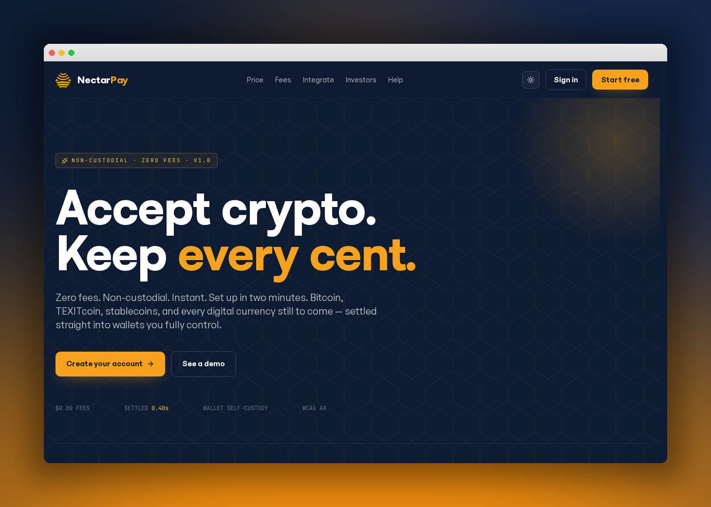
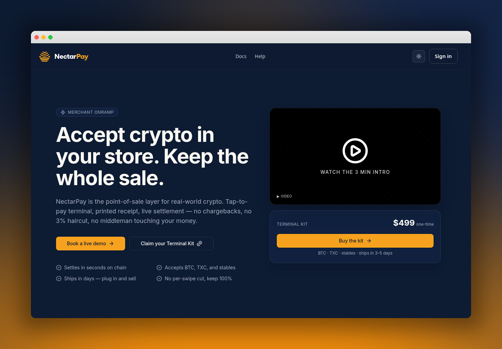
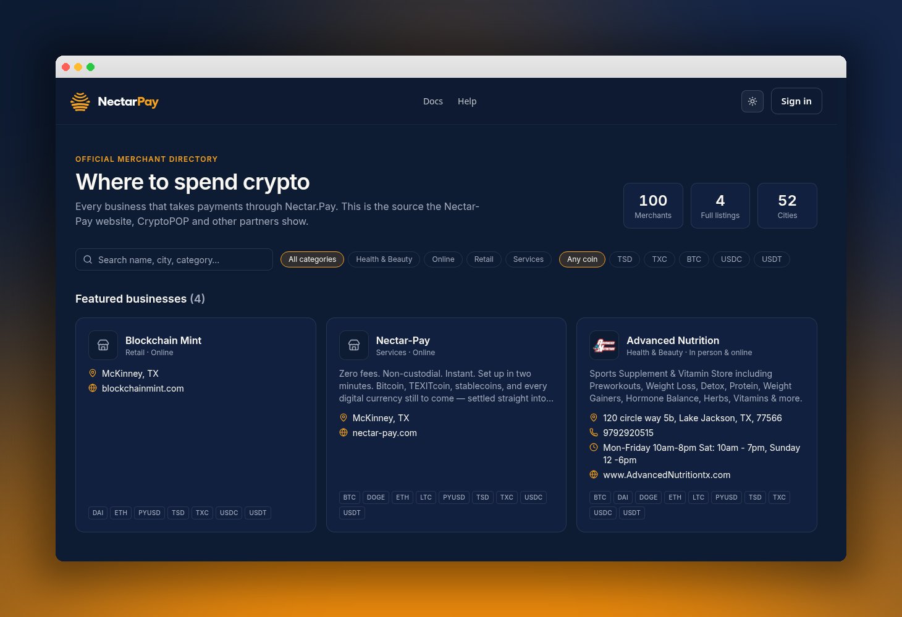

<p align="center">
  
</p>

<h1 align="center">Nectar.Pay</h1>

<p align="center">
  <strong>Take crypto the way you take cash.</strong><br>
  A customer pays. The money lands in the shop's own wallet. We never hold it, never freeze it, and never take a cut of the sale.
</p>

<p align="center">
  <a href="https://app.nectar-pay.com"></a>
  
  
  
  
  
</p>

---

**Nectar.Pay is the till for honest money.** A shop owner links their own wallet once, sticks
a QR code on the counter, and starts taking Bitcoin, TEXITcoin and digital dollars. Every
payment goes straight from the customer's wallet to the shop's wallet. There's no account
balance sitting with us, no payout to wait for, and no percentage skimmed off the top.

It's built for the people behind the counter: a barista, a bar owner, a market stall, a
one-person web shop. If you can scan a coin and sign your name, you can take crypto today.

## Contents

**For Bobby and backers**
- [Why it exists](#why-it-exists)
- [Where it's at](#where-its-at)
- [How money moves](#how-money-moves)

**For merchants**
- [Getting started: the Fast Start Program](#getting-started-the-fast-start-program)
- [What happens when a customer pays](#what-happens-when-a-customer-pays)
- [Running your shop](#running-your-shop)
- [Give Back](#give-back)
- [POP rewards](#pop-rewards)
- [Your money stays yours](#your-money-stays-yours)
- [Coins you can take](#coins-you-can-take)

**For the technical team**
- [Quick start](#quick-start) · [Repo map](#repo-map) · [How a payment settles](#how-a-payment-settles)
- [Public API](#public-api) · [Drop-in checkout](#drop-in-checkout) · [Shop plugins](#shop-plugins)
- [Mobile apps](#mobile-apps) · [Security details](#security-details) · [Tests](#tests-and-quality) · [Docs](#docs-in-this-repo)

[The ecosystem](#the-ecosystem)

---

# For Bobby and backers

## Why it exists

> *Every payment is a vote. When a customer pays with honest money, they walk a small piece of
> the economy out from under the printing press.*
> — [The Nectar-Pay Manifesto](https://app.nectar-pay.com/manifesto)

Card processors and online payment companies sit between a shop and its money. They take a
percentage of every sale, hold the funds for days, and can shut a merchant off whenever they
choose. Nectar.Pay removes the middle:

- **The merchant holds the money, not us.** Every sale settles to an address the merchant
  controls. We can't touch it, so we can't freeze it.
- **No percentage of the sale.** A percentage fee is a tax on doing well. Merchants pay a flat
  price instead (see [pricing](#what-it-costs)).
- **One till, many currencies.** Bitcoin, TEXITcoin, its TSD stable dollar, and the main
  digital dollars all come in through the same counter.

It continues the work Bobby Gray started in 2008 with the American Open Currency Standard and
carried on in 2024 with TEXITcoin. Nectar.Pay is one piece of the
[Honest Money Ecosystem](https://honest.money).

## Where it's at

*Figures read from the live system on Nov 20, 2026.*

| | |
|---|---|
| **196** | stores set up |
| **69** | stores that have taken at least one paid sale |
| **617** | paid sales since the first one on June 21, 2026 |
| **218** | of those in the last 30 days |
| **≈ $433,500** | in dollar-priced sales, every cent paid straight to merchants' own wallets |
| **$0** | of customer money ever held by Nectar.Pay |

**Working today**

- Shops take payments from a printed sticker, a hosted pay link, the in-store register, or a
  checkout on their own website.
- New merchants sign up and go live on their own through the Fast Start Program.
- Owners get a Telegram message and an email the moment a sale lands, and customers get a
  receipt, including their signature when they signed for the sale.
- Give Back and POP rewards are switched on in the app.
- A public map and directory shows which shops take crypto.
- Nine ready-made plugins connect popular online shop systems, and an Android register app
  runs on payment terminals.

**Still to finish**

| What | Waiting on |
|---|---|
| CryptoPOP reporting a sticker payment back right after it's sent | CryptoPOP adding that step on their side |
| First real tap with a funded card on a physical terminal | A paired terminal, a funded card and the cardholder's approval |
| A brand-new Fast Start signup checked end to end | A fresh, unused Cold Storage Coin |
| Letting a merchant take over a starter store as their own | A safe way to prove they own it |
| Text-message and WhatsApp alerts | Put on hold by Bobby; needs Twilio and Meta approval |

## How money moves

```text
   customer                 Nectar.Pay                  merchant wallet
      │                          │                             │
      │  scan sticker / open link│                             │
      ├─────────────────────────>│                             │
      │                          │  make a brand-new address   │
      │                          │  from the merchant's wallet │
      │  "send 412.03 TSD"       │                             │
      │<─────────────────────────┤                             │
      │                          │                             │
      │  pay from their wallet   │                             │
      ├──────────────────────────────────────────────────────> │
      │                          │                             │
      │                     watch the blockchain ────────────> │  money arrives
      │                          │                             │
      │                          │  right amount? record it    │
      │  receipt + shop alert    │  email · Telegram · website │
      │<─────────────────────────┤<────────────────────────────┤
```

Money only ever moves **customer → merchant**. Nectar.Pay watches, matches the payment to the
bill, and tells everyone what happened.

---

# For merchants

## Getting started: the Fast Start Program

<p align="center">
  
</p>

1. **Get your kit.** You receive a Cold Storage Coin and a sheet of matching stickers. The
   coin's ID is your merchant code, and capital letters count.
2. **Open [app.nectar-pay.com/fast](https://app.nectar-pay.com/fast)** on a tablet or phone.
   Type your website first and we fill in your business details from it for you to check.
3. **Scan the coin.** That fills in the coin ID and its wallet key, so payments go straight to
   the coin.
4. **Sign on screen** and tick the agreements. Choose whether to appear in the public shop
   directory.
5. **You're live straight away.** No waiting for approval. New stores start out taking TSD on
   TEXITcoin.
6. **Check your email.** The welcome message has your sticker link, a link to switch on
   Telegram alerts, and a link to create your login.
7. **Try it.** Make a test payment of any amount and watch the alert arrive.

Fast Start is open to shops in the United States for now.

### What it costs

There's no percentage taken from any sale. The terminal kit, including the first year, is
**$799**, which covers the **$300** first-year merchant fee. See
[app.nectar-pay.com/onramp](https://app.nectar-pay.com/onramp).

## What happens when a customer pays

1. The customer scans your sticker, taps their card on your terminal, or picks crypto at your
   online checkout.
2. They type the amount (or the register fills it in) and pay from their own wallet.
3. The money goes straight to your wallet. A sticker takes any amount, from a coffee to a car.
4. You get a Telegram message and an email. The customer gets a receipt.
5. If someone pays too little, too much, or in a way that doesn't match a bill, it's set aside
   on your **unmatched payments** list for you to sort out. Nothing is guessed.

## Running your shop

| | |
|---|---|
| **Register** | A point-of-sale screen with your products, cash and crypto, tips, change, signatures, and printed or emailed receipts. |
| **Tap-to-pay cards** | Customers tap a CryptoPOP card on your terminal, type a PIN, and pay. |
| **Alerts** | Telegram and email for every sale, anything that looks wrong, and any change to your wallet. |
| **Reports** | Daily sales by payment type, in your own time zone, with downloads for your bookkeeper. |
| **Customer list** | Everyone who bought from you. A receipt email never counts as permission to market to them; that's a separate box the customer ticks themselves. |
| **Team** | Staff logins with their own permissions, and a history of changes nobody can edit. |
| **Directory** | An optional listing on the public map of shops that take crypto. |
| **Guide** | A 12-chapter illustrated guide inside the app under **Docs**, from signing up to tap cards. |

## Give Back

Switch it on yourself in your store's payment settings. Customers paying in TSD get **10% off**,
and that one payment is split in a single transaction:

| You receive | The customer's charity | The program |
|:---:|:---:|:---:|
| **90%** | **8%** | **2%** |

Rewards are still earned on the full price. The charity and program shares can't be refunded;
only your share can, and the receipt says so.

## POP rewards

Customers earn **1 POP for every dollar** of the full sale, rounded up to a whole POP, at every
Nectar.Pay shop and for every way of paying. POP are reward points, not spending money, and
CryptoPOP sends them out. Each sale can only earn once, and there are limits to stop abuse:
no rewards for buying from your own store, a 14-day wait for brand-new stores, up to 250 POP per
customer per store per day, and up to 5,000 POP per store per day.

## Your money stays yours

- **There's nothing here to steal.** We never have your private keys or a balance of your money.
- **Nobody can mark a sale paid by hand.** Only a real payment on the blockchain does that.
- **Changing your wallet is slow on purpose.** It needs a code emailed to you, a new wallet waits
  four hours before it can receive payments, and you always get an alert you can't switch off.
- **Throwaway email addresses can't sign up.**
- **Website keys can create bills and read sales, but can never move money.**

## Coins you can take

| Coin or network | Status | Notes |
|---|---|---|
| **TEXITcoin** | live | TEXITcoin plus **TSD**, its stable dollar. The home network. |
| **Bitcoin** | live | |
| **Litecoin / Dogecoin** | live | |
| **Ethereum** | live | ETH plus the digital dollars USDC, USDT, PYUSD and DAI. |
| **Base** | live | ETH plus USDC, USDT and DAI. |
| **Zero Chill Units (ZCU)** | live | ZCU only. |
| **BNB Chain** | not offered, but watched | Hidden from customers. Digital dollars sent here by mistake are still picked up and credited. |
| **Tron, Solana, Bitcoin Cash, Dash** | retired | No new bills. |
| **Bitcoin Lightning** | off | |
| **ISK** | coming | Works like TEXITcoin. |

---

# For the technical team

## Quick start

You need [Bun](https://bun.sh) and a Lovable Cloud backend for this project.

```bash
bun install
bun run dev        # http://localhost:8080
```

The backend URL and publishable key are written into `.env` by Lovable Cloud — you don't hand
edit them. Chain providers (Alchemy), email (AWS SES), Telegram, and partner signing secrets
live as server-side environment variables; the app runs with whatever is present and hides the
features that need a missing one.

| Command | What it does |
|---|---|
| `bun run dev` | Dev server with hot reload. |
| `bun run build` | Production build. |
| `bun run preview` | Serve the built app. |
| `bun run lint` / `bun run format` | ESLint and Prettier. |
| `bunx vitest run` | The full test suite. |
| `bun run sync:terminal` | Sync the POS app into its Android project. |
| `bun run sync:merchant` | Sync the merchant app into its iOS/Android projects. |

## Repo map

```text
src/
  routes/            144 route files: merchant app, checkout, docs, /api/public/v1/*
  lib/               domain logic — chains, wallet-link, vault-link, give, pop, email, sdk
    chains/          one watcher per network (BTC-like, EVM, Omni, Solana, Tron, ZCU, …)
  components/        UI, including the admin list sort header
  integrations/      generated backend client (don't hand edit)
  styles.css         Tailwind v4 theme — the navy/amber design tokens
supabase/migrations/  95 migrations, applied in order
docs/                handoff notes for partners and teammates
public/              9 shop plugins, the JS SDK, how-to screenshots, llms.txt, openapi.json
android/             the POS terminal app (Capacitor)
scripts/             keystore and iOS prep helpers
.github/workflows/   pos-apk.yml — builds and signs the terminal APK
AGENTS.md            the project's own rules, and one per folder
roadmap.md           what's done, what's next
```

## How a payment settles

1. **A bill is created.** A fresh receive address is derived from the merchant's own public
   key, so every sale gets an address that has never been used before, and the private key
   never touches this server.
2. **The chain is watched.** A cron watcher reads each network, and Alchemy push notifications
   act as a hint for the EVM chains. A hint is never trusted on its own — the shared on-chain
   scanner confirms it.
3. **Matching is exact.** The amount has to match the bill. Under- and over-payments are
   recorded as what they are, and anything that can't be matched goes to a merchant-visible
   *unmatched payments* pile instead of being guessed at.
4. **Settlement writes one row.** A guarded, idempotent database function records the
   transaction and settles the sale exactly once, even if two watchers race.
5. **Everyone is told.** Email, Telegram, and the merchant's own webhook all come out of a
   durable outbox, so a callback can't be lost mid-request, and retries keep going for up to
   24 hours.

## Public API

Base URL `https://app.nectar-pay.com` · auth `Authorization: Bearer sk_live_...` ·
120 requests/minute per key (429 + `Retry-After`).

| Method | Path | What it does |
|---|---|---|
| `GET` | `/api/public/v1/me` | Who this key belongs to. |
| `POST` | `/api/public/v1/invoices` | Create a bill and get its checkout URL. |
| `GET` | `/api/public/v1/invoices` | List this key's bills, filterable. |
| `GET` | `/api/public/v1/invoices/{id}` | One bill and its payment state. |
| `POST` | `/api/public/v1/invoices/{id}/email` | Email the receipt to a buyer. |
| `GET` | `/api/public/v1/invoices/{id}/webhooks` | Delivery log for one bill. |
| `GET` | `/api/public/v1/rates` | Current exchange rates. |
| `GET` | `/api/public/v1/store` | Public store profile. |
| `GET`/`POST` | `/api/public/v1/links` | Hosted pay links (also `PATCH`/`DELETE /{slug}`). |
| `GET` | `/api/public/v1/directory` | The public merchant directory. |

```bash
curl -X POST https://app.nectar-pay.com/api/public/v1/invoices \
  -H "Authorization: Bearer sk_live_..." \
  -H "Content-Type: application/json" \
  -d '{
        "amount": 25,
        "currency": "USD",
        "chain": "txc",
        "order_id": "order-123",
        "description": "Espresso flight",
        "redirect_url": "https://yourshop.test/thanks"
      }'
```

```json
{
  "id": "5954d3c4-…",
  "address": "TXC1q…",
  "crypto_amount": 412.03,
  "rate": 0.6067,
  "checkout_url": "https://app.nectar-pay.com/i/5954d3c4-…",
  "expires_at": "2026-11-20T13:04:00Z"
}
```

`chain` is optional — leave it out and the shopper picks their own coin.

### Webhooks

Every event is signed. Verify before you trust it:

```js
import crypto from "node:crypto";

// Header: X-TXCPay-Signature: t=<unix>,v1=<hex>
function verify(rawBody, header, webhookSecret) {
  const t = Number(header.match(/t=(\d+)/)[1]);
  const got = header.match(/v1=([0-9a-f]+)/)[1];
  const want = crypto
    .createHmac("sha256", webhookSecret)
    .update(`${t}.${rawBody}`)
    .digest("hex");
  return (
    crypto.timingSafeEqual(Buffer.from(got, "hex"), Buffer.from(want, "hex")) &&
    Math.abs(Date.now() / 1000 - t) < 300
  );
}
```

Events: `invoice.paid`, `invoice.underpaid`, `invoice.overpaid`, `invoice.confirmed`.
Retries back off over 24 hours, up to eight attempts.

## Drop-in checkout

One script tag and a button:

```html
<script src="https://app.nectar-pay.com/sdk/payhme.js"></script>

<button data-payhme
        data-api-key="sk_live_..."
        data-amount="25"
        data-currency="USD"
        data-chain="txc"
        data-order-id="order-123">
  Pay with crypto
</button>
```

Or drive it yourself and listen for the result:

```js
const result = await PayHME.checkout({ amount: 25, currency: "USD", chain: "txc" });
// { status: "paid" | "closed" | "expired", invoiceId, tx }
```

No code at all: create a hosted link and send shoppers to `https://app.nectar-pay.com/t/<slug>`,
or point a printed sticker at `https://app.nectar-pay.com/s/<code>`.

<p align="center">
  
</p>

## Shop plugins

Ready-to-install modules for the shops people already run — each one is a downloadable archive
under `public/plugins/`:

**WooCommerce** · **Magento 2** · **PrestaShop** · **OpenCart** · **CS-Cart** · **Zen Cart** ·
**WHMCS** · **Easy Digital Downloads** · **Craft Commerce**

## Mobile apps

| App | How it ships |
|---|---|
| **POS terminal** | A signed Android APK built by the `POS APK` GitHub Action — push the `pos-app` branch or tag `pos-v*`, and the download lands at `/pos.apk`. |
| **Merchant app** | A Capacitor wrapper around the web app (`bun run sync:merchant`, then open it in Xcode or Android Studio). |

## Security details

- **Nothing to steal.** No private keys, no stored balances, no withdrawal queue.
- **Row-level security everywhere.** Every table is locked down by policy; some columns
  (webhook secrets, terminal and API-key secrets) are readable only through narrow,
  server-side paths.
- **Merchants can't mark their own sales paid.** A database trigger rejects any client-side
  write that would set payment or status fields.
- **Payout changes are slow on purpose.** Swapping a wallet key needs a code emailed to the
  owner, and a replacement key waits four hours before it can receive anything. Every change
  lands in an append-only audit trail, and the alert cannot be muted.
- **Links are checked twice.** Any URL the app will navigate to or hand to a customer must
  pass a safe-HTTP check, at input and again before use.
- **Throwaway signups are stopped in the database**, not just on the screen.
- **Unmatched money is parked, never guessed.** Payments that don't fit a bill wait for a
  human rather than being auto-credited.

## Tests and quality

```bash
bunx vitest run
```

**45 test files, 240 tests**, covering the parts that must not break: invoice write guards,
address derivation, exact-match settlement, webhook signing and replay, wallet-link pairing,
give splits, POP eligibility, and the retired-network switches. Security tests run under a
standalone Vitest config so they don't need the whole app to boot. TypeScript runs in strict
mode.

## Docs in this repo

| File | For |
|---|---|
| `docs/CRYPTOPOP_STICKER_HANDOFF.md` | NFC sticker payments and terminal pairing |
| `docs/WALLET_SMART_QR_HANDOFF.md` | Wallet-side QR lookup |
| `docs/PARTNER_SIGNING_HANDOFF.md` | Partner request signing |
| `docs/AFFILIATE_SALE_WEBHOOK.md` | Referral and affiliate reporting |
| `docs/BM_FULFILLMENT_ENDPOINT.md` | Order fulfilment for a partner |
| `docs/DEMO_SCRIPTS.md` | Walkthroughs for live demos |
| `docs/LOVABLE_CONNECTOR_LISTING.md` | Connector listing copy |
| `AGENTS.md` | The rules this project runs by, with one per folder |
| `roadmap.md` | What's shipped and what's next |

Merchants get their own illustrated guide in the app at **Docs** — twelve chapters from
enrollment to tech stuff.

---

# The ecosystem

Nectar.Pay is one piece of the **Honest Money Ecosystem** — [honest.money](https://honest.money).

- [TEXITcoin](https://texitcoin.org/build) — the blockchain this runs on, with TSD on its Omni layer
- [Zero Chill Units](https://zerochill.com/build) — an EVM fork with its own RPC and explorer
- [Beekeeper](https://beekeeper.honest.money) — a wallet you can link straight to a store
- HME Vault and HME SSO — link a merchant's wallet by QR, and sign in across the ecosystem

---

<p align="center">
  Part of the <a href="https://honest.money">honest.money</a> ecosystem ·
  <a href="https://app.nectar-pay.com/terms">Terms</a> ·
  <a href="https://app.nectar-pay.com/privacy">Privacy</a> ·
  <a href="https://app.nectar-pay.com/manifesto">Manifesto</a>
</p>

<p align="center">
  <sub>Private and proprietary. No license is granted to this code. Money moves only between a
  shopper and a merchant — this software never holds funds.</sub>
</p>
